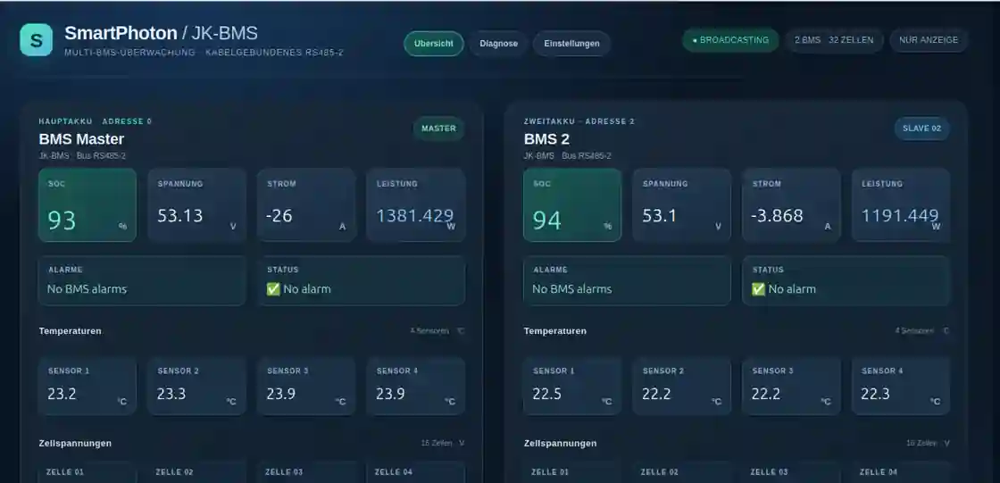

# Field validation — 10 November 2026

**Project:** ioBroker.hass-mqtt-next 0.1.0-dev.1  
**Status:** successful **functional** integration on real equipment; **not** a stable/adopted ioBroker adapter release.

## Objective

Demonstrate that a new independent, read-only Home Assistant MQTT Discovery importer can display real data published by an existing JK-BMS application in ioBroker, including German/English VIS-2 views, without replacing or modifying the JK-BMS publisher.

## Actual setup (not a visual simulation)

- Two **physical** JK-BMS battery packs: RS485 bus, addresses **0 (master)** and **2**, 16 cells per pack.
- Data publisher: **SmartPhoton JK-BMS Legacy 4.1.12**, Docker standalone, serial `/dev/ttyUSB0`, 115200 8N1, broadcasting mode.
- MQTT broker: **Mosquitto 2.0.21**, loopback and Docker bridge listeners, password authentication and ACLs.
- ioBroker: Debian 13 / Node.js **24.22.2** / js-controller **7.2.5**.
- Official MQTT adapter: **9.2.0**, operating as a client, subscribed to Discovery and the two BMS data trees.
- Discovery importer: **hass-mqtt-next.0**, version **0.1.0-dev.1**.
- Display: ioBroker VIS-2, three pages **per language** (German and English): overview / diagnostics / settings.

The public guide deliberately omits real IPs, hostnames, broker credentials, device serial numbers, user-specific IDs and raw captures.

## Screenshot — real dual JK-BMS in VIS-2

*German-language overview from the test system. BMS readings are representative of a moment in time; labels and layout belong to a separate VIS-2 project.*

## Observed results

| Check | Observation |
|---|---|
| Serial interface | Opened successfully at 115200 baud; data publisher running |
| Broker | MQTT connection established |
| Physical data | 345 **non-retained** MQTT topic messages observed from master and 345 from BMS address 2 during a 20-second sample |
| Importer | `hass-mqtt-next.0.info.connection=true` |
| Imported objects | 237 entity **value** objects counted in the test system |
| Distribution | 113 IDs matched the master, 113 matched BMS 2, 11 additional/other IDs; exact composition not fully audited |
| Basic Discovery | Sensor, binary sensor, read-only switch and read-only number types validated in isolated live-broker tests |
| Availability | `.available` switched offline/online without spuriously changing the last measurement timestamp in the controlled test |
| VIS-2 | German and English three-page displays showed live values from both packs, including 32 cell voltages and diagnostic/settings values |

Representative state structure:

~~~text
hass-mqtt-next.0.entities.sensor.bms_master_bms_Cell_1_volt_<hash>.value
hass-mqtt-next.0.entities.sensor.bms_2_bms_Cell_1_volt_<hash>.value
hass-mqtt-next.0.entities.number.<generated_id>.value
~~~

All created entity state objects sampled in the isolated tests had `common.read=true`, `common.write=false`, and values with `ack=true`. In the source, the adapter does not subscribe to `command_topic`, nor publish MQTT messages. The real-world test used **broker-side read-only privileges** for the ioBroker MQTT account as an additional safeguard.

## What this does *not* prove

- No exhaustive proof that all 237 entities refresh correctly under every operating condition.
- No day-long/multi-day endurance, fault-injection, or broad compatibility matrix across ioBroker versions.
- No audited generic package installation through the public adapter directory or npm.
- No proof of comprehensive Home Assistant Discovery compliance. Complex templates, `climate`, `light`, `select` etc. remain unsupported.
- No guarantee that a missing/offline BMS is detected without valid physical availability topics. Retained values may be stale.
- No proof about command capabilities of *other* adapters on the same broker; secure MQTT ACLs are still necessary.

The VIS-2 dashboards used project-specific state ID mappings and are **not bundled or auto-installed by this source adapter**. The imported state IDs intentionally differ from those of the older 2019 `hass-mqtt.0` adapter.

## Reproduce on an isolated system

See the [English guide](GETTING_STARTED.md) or [German guide](ERSTE_SCHRITTE_DE.md). For first-time users the easiest test is an existing MQTT Discovery publisher plus an ioBroker installation with the official MQTT client; **you do not need SmartPhoton or a JK-BMS**.

The original 2019 adapter remains credited in [the technical audit](AUDIT_2019.md). This preview is an independent implementation, not a drop-in fork or an official ioBroker release.
